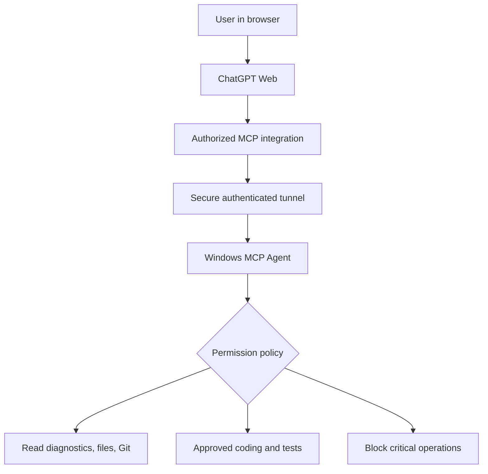

<p align="center">
🌐 <strong>Documentation / Documentação / Documentación</strong><br>
<a href="README.en.md">🇺🇸 English</a> · <a href="README.md">🇧🇷 Português (Brasil)</a> · <a href="README.es.md">🇪🇸 Español</a>
</p>

<div align="center">

# 🚀 CHATGPT WEB + WINDOWS AGENT
## 🔥 TURN YOUR PC INTO AN AI DEVELOPMENT WORKSTATION + CODE FOR FREE!

**STOP COPYING COMMANDS. BUILD, DEBUG, TEST AND IMPROVE SOFTWARE DIRECTLY FROM CHATGPT WITH A CONNECTED WINDOWS AGENT.**

  

### 💥 CODE FOR FREE: BUILD, ANALYZE, TEST AND FIX CODE WITH CHATGPT + WINDOWS AGENT!

Describe your project, website, automation or bug in natural language. A securely connected **Windows MCP Agent** can inspect authorized files, run allowed commands, execute tests and propose changes. You can assemble the local development stack from **free and open-source software**. **ChatGPT models and connectors have account, plan, quota and service limits: free local coding tools do not mean unlimited free AI requests.**

[Installation](#-complete-step-by-step-installation) · [Security](#-security-first) · [Examples](#-15-copy-ready-prompts) · [Troubleshooting](#-troubleshooting)

</div>

---

## 🧬 THE ACTUAL ARCHITECTURE




ChatGPT does **not** automatically control the PC merely because a browser tab is open. You need: **(1)** a compatible MCP server with Windows tools, **(2)** an authenticated connection supported by the account, and **(3)** a strict authorization policy. Never open an unprotected MCP port on your router.

> **Real reference installation:** a custom `windows-pc-agent-ultimate` server reported 39 tools, a non-administrator operator, a protected tunnel, health monitoring and critical-action checks. This repository documents a reproducible approach, **but does not contain that custom agent or a one-click installer**.

## 🧰 OFFICIAL DOWNLOADS AND LINKS

| Component | Official address |
|---|---|
| ChatGPT | https://chatgpt.com/ |
| MCP documentation | https://modelcontextprotocol.io/docs/getting-started/intro |
| MCP specification | https://modelcontextprotocol.io/specification/ |
| PowerShell 7 | https://github.com/PowerShell/PowerShell |
| Windows Terminal | https://learn.microsoft.com/windows/terminal/ |
| Git | https://git-scm.com/downloads/win |
| GitHub | https://github.com/ |
| Visual Studio Code | https://code.visualstudio.com/ |
| Python | https://www.python.org/downloads/ |
| Node.js | https://nodejs.org/ |
| WSL2 | https://learn.microsoft.com/windows/wsl/install |
| Docker Desktop (optional) | https://docs.docker.com/desktop/setup/install/windows-install/ |
| ChatGPT support | https://help.openai.com/ |

---

# 🏁 COMPLETE STEP-BY-STEP INSTALLATION

## STEP 0 — Prepare safely

Use updated Windows 10/11, an updated browser, a ChatGPT account, a reliable network connection, and a backup of important projects. Start with **read-only access**. A coding agent should never receive unrestricted administrator access by default.

## STEP 1 — Install the terminal and free development tools

Open Windows PowerShell and run the following **official winget package identifiers**:

```powershell
winget --version
winget install --id Microsoft.WindowsTerminal --exact
winget install --id Microsoft.PowerShell --exact
winget install --id Git.Git --exact
winget install --id Microsoft.VisualStudioCode --exact
winget install --id Python.Python.3.13 --exact
winget install --id OpenJS.NodeJS.LTS --exact
```


If a package version is unavailable, run `winget search Python.Python` or consult the linked official documentation. Reopen the terminal when installation completes. Check the versions:

```powershell
$PSVersionTable.PSVersion
git --version
code --version
python --version
node --version
npm --version
```


For Git commits, configure **your own** identity:

```powershell
git config --global user.name "YOUR NAME"
git config --global user.email "your-email@example.com"
```

## STEP 2 — Create an isolated workspace

```powershell
$Workspace = Join-Path $HOME 'AI-Workspace'
New-Item -ItemType Directory -Force -Path $Workspace
Set-Location $Workspace
```


Keep agent file permissions restricted to this directory initially rather than exposing all of `C:\`.

## STEP 3 — Optionally add Linux with WSL2

```powershell
wsl --status
wsl --list --verbose
# Run only if WSL is not yet installed, with the required privileges:
wsl --install -d Ubuntu
```


Installing WSL may require elevated privileges and a Windows restart. Do this only during a safe maintenance window. After completing Ubuntu setup, validate with `wsl -d Ubuntu -- uname -a`.

## STEP 4 — Clone this guide

```powershell
Set-Location (Join-Path $HOME 'AI-Workspace')
git clone https://github.com/StockNewsBR/Use-ChatGPTG-Web-to-control-your-PC-e-Code-for-Free-.git
Set-Location Use-ChatGPTG-Web-to-control-your-PC-e-Code-for-Free-
git status
git remote -v
```


**Important:** cloning this repository downloads documentation, **not** a working Windows MCP agent or tunnel client.

## STEP 5 — Choose or implement a Windows MCP server

Follow the [official MCP server documentation](https://modelcontextprotocol.io/docs/learn/server-concepts). You may implement your own server using an appropriate SDK, or evaluate a trustworthy third-party implementation. Review the source, licensing, commands, data exposure and privilege model. Installing an SDK alone does not provide Windows control. The custom reference agent is **not distributed in this repository**.

## STEP 6 — Start with read-only tools

Allow system information, CPU/RAM/disk inventory, scoped file reads, Git status and safe logs. Disable arbitrary shell commands, file deletion, credentials, firewall, services, elevation, mouse/keyboard automation and public posting. Enable audit logs with secrets redacted.

Example **conceptual policy only** (the format depends on your actual server):

```yaml
policy_example_only:
  read_tools: true
  write_tools: false
  delete_tools: false
  arbitrary_shell: false
  elevation: false
  audit_log: true
  require_approval_for_critical_actions: true
```

## STEP 7 — Connect through an authenticated tunnel

Expected path: `ChatGPT Web → authorized MCP connector → encrypted/authenticated tunnel → local Windows MCP server → allowed tools`. Bind local listeners to loopback where practical, store credentials in a protected system store such as DPAPI, and allow revocation. **Do not** forward a raw MCP port to the internet. There is no universal installer command for all connector providers.

## STEP 8 — Add the supported connection in ChatGPT

1. Open [ChatGPT](https://chatgpt.com/).
2. Find **Settings → Apps/Plugins/connectors**, as available for your account.
3. Verify availability of the required custom MCP integration; menu names and eligibility vary.
4. Register only the officially supported, authenticated connector endpoint.
5. Review scopes and grant the minimum permissions.
6. Start a new chat and select the connected tool, if required.

If the connector is unavailable, consult the [OpenAI Help Center](https://help.openai.com/). Do not bypass access controls.

## STEP 9 — Verify end-to-end access

Ask: **“Use my connected Windows agent to list its tools, server version and allowed folders. Read-only: do not change anything.”**

Then ask for actual CPU and memory metrics. A successful test requires a **real tool result from your machine**, not a generic AI answer. In the reference installation the tool `pc_agent_capabilities` returned a 39-tool catalog; your tools may be completely different.

## STEP 10 — Allow coding with review gates

Gradually enable Git inspection, predefined tests, scoped workspace file edits, then explicitly approved commits and pushes. Require a visible diff before writing, run tests afterward, and show evidence. Keep backup and rollback options. Never automatically push to production without authorization.

## STEP 11 — Optional always-on startup

Configure a least-privilege Windows scheduled task at the intended user's logon **only after** validating the connection. Use absolute paths, DPAPI-protected secrets, mutex/lock to avoid duplicate tunnels, health monitoring, and recovery checks. Test a reboot only when authorized.

## STEP 12 — Confirm your definition of done

- [ ] Windows tools installed and version-checked
- [ ] Workspace limited and backed up
- [ ] MCP server handshake works
- [ ] Tunnel authenticates without exposed credentials
- [ ] ChatGPT receives real tool results
- [ ] Read-only operations confirmed
- [ ] Writes require separate approval
- [ ] Logs do not leak tokens
- [ ] Startup recovery tested if enabled

---

# 🎯 15 COPY-READY PROMPTS

1. **PC health:** “Read CPU, RAM, GPU, disks and process metrics. Do not change anything.”
2. **Disk usage:** “Find the largest permitted folders. Recommend cleanup but delete nothing.”
3. **Slow PC:** “Inspect bottlenecks and startup applications; do not stop processes.”
4. **Network:** “Show whether Ethernet or Wi-Fi is used, based on actual routes. Read-only.”
5. **GPU:** “Inspect drivers and GPU workloads without installing anything.”
6. **Repository map:** “Analyze architecture and testing commands for my authorized repository.”
7. **Debug:** “Find the root cause and propose a minimal patch before editing.”
8. **Tests:** “Run allowed tests and separate code failures from environment issues.”
9. **Security audit:** “Look for dependency risks and exposed secrets, but never print secrets.”
10. **Git review:** “Show the diff and proposed commit; wait for approval before pushing.”
11. **WSL:** “Inspect Linux distributions and WSL health without restarting them.”
12. **Docker:** “Report containers, images, volumes and disk use. Do not prune.”
13. **Logs:** “Correlate permitted service logs; do not restart the service.”
14. **New app:** “Propose files for an application in my workspace; ask before writing.”
15. **Full audit:** “Provide evidence-based PASS/WARN/FAIL for Windows, Git, network, WSL and Docker without changes.”

---

# 🔒 SECURITY FIRST

| Operation | Initial policy |
|---|---|
| Read system inventory | ✅ Allow |
| Read Git status / diff | ✅ Allow |
| Read files within approved workspace | ✅ Allow |
| Modify code | 🔐 Restrict and approve |
| Run arbitrary commands | ⛔ Initially disable |
| Delete files or Docker volumes | ⛔ Critical approval |
| Modify firewall / credentials / services | ⛔ Block |
| Screen, keyboard or mouse control | ⛔ Separate explicit permission |
| Push or publicly publish | 🔐 Explicit approval |

Never publish passwords, API keys, cookies, DPAPI files or logs containing tokens. Avoid unreviewed remote execution pipelines. To disconnect, revoke the connector, stop the known tunnel client and review sanitized logs. Change credentials if compromise is suspected.

# 🧯 TROUBLESHOOTING

| Symptom | Check |
|---|---|
| No connector in ChatGPT | Plan/availability and Apps/Plugins settings |
| Local agent works but ChatGPT cannot reach it | Supported connector, authentication, tunnel and endpoint |
| Invalid key or authentication | Protected credential, correct scope, provider-side validity |
| Tool denied | Agent policy and allowed roots |
| Two tunnel instances | Startup task, mutex, watchdog and fallback |
| Git/Python/Node not recognized | Reopen shell and inspect PATH |
| WSL not available | Virtualization prerequisites and pending reboot |
| AI claims an action without proof | Require actual MCP tool result and logs |

# 💸 WHAT DOES “CODE FOR FREE” MEAN?

Git, VS Code, PowerShell, WSL, Python and Node.js can power a free local development environment. Your ChatGPT plan, connector eligibility, tunnel provider and model/API quotas may still incur charges or usage limits. **Free coding workflow ≠ unlimited model access**.

## ❓ FAQ

**Can I use the browser alone?** No. ChatGPT must connect to an installed authorized agent.

**Does this install the custom ULTIMATE agent?** No. This is an architecture and setup guide.

**Can it control the mouse?** Only if a separately permitted agent implements UI automation.

**Can it write code?** Yes, when the connected agent offers scoped file and execution tools and you authorize them.

**Does it support any GPT model?** Use the models and tooling currently offered by your account; no specific version is guaranteed.

## 📚 LEARN MORE

[MCP](https://modelcontextprotocol.io/docs/getting-started/intro) · [Windows WSL](https://learn.microsoft.com/windows/wsl/install) · [Git](https://git-scm.com/doc) · [VS Code](https://code.visualstudio.com/docs) · [GitHub Docs](https://docs.github.com/) · [DeepSeek Harness 2.0 GOD SETUP](https://github.com/StockNewsBR/New-DeepSeek-Harness-2.0-GOD-Setup)

<div align="center">

## 🚀 BUILD WITH AI. VERIFY THE RESULTS. KEEP CONTROL OF YOUR COMPUTER.

**⭐ Star this repository if the tutorial helped you!**

</div>

---

<div align="center">

## 🤝 Sponsorship / Sponsored by

<a href="https://iamarketmaster.com"></a>

### [🚀 IA Market Master](https://iamarketmaster.com) · [📈 StockNewsBR](https://stocknewsbr.com)

**IA Market Master — Marketing OS** · **StockNewsBR — AI Market Intelligence**

</div>
