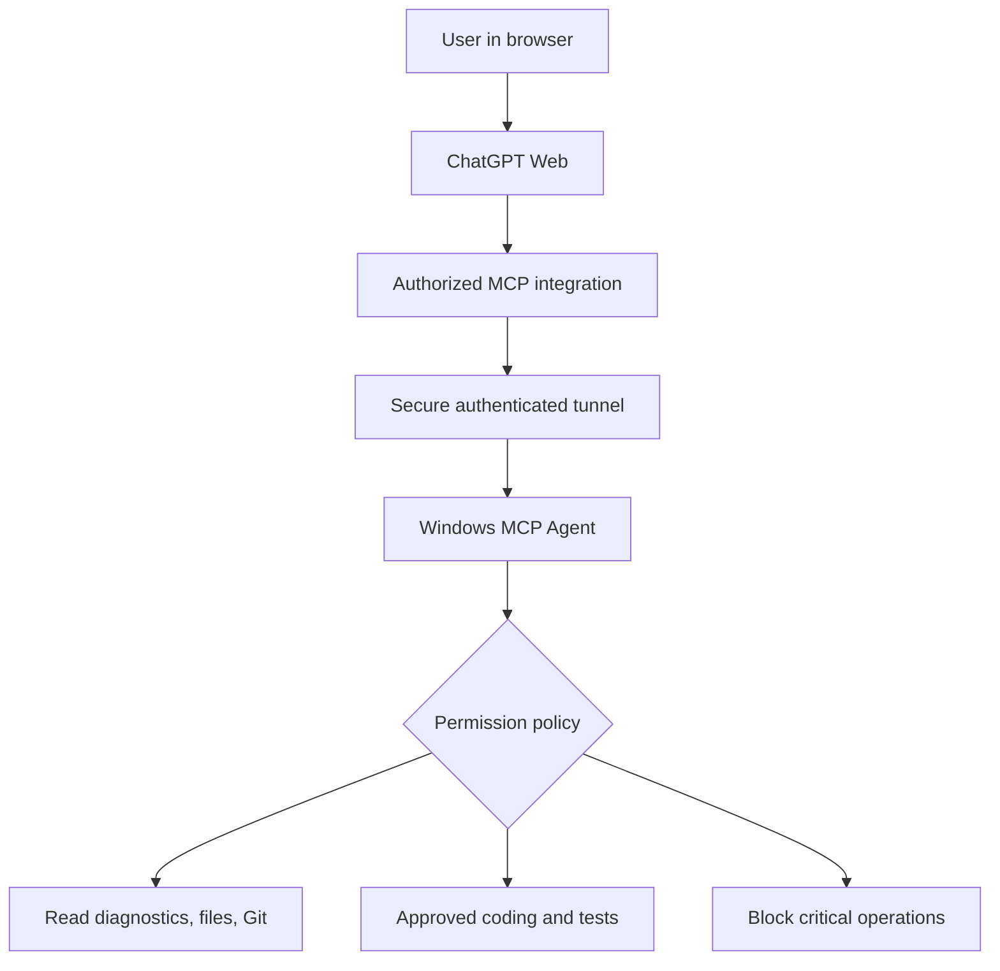

<p align="center">
🌐 <strong>Documentation / Documentação / Documentación</strong><br>
<a href="README.en.md">🇺🇸 English</a> · <a href="README.md">🇧🇷 Português (Brasil)</a> · <a href="README.es.md">🇪🇸 Español</a>
</p>

<div align="center">

# 🚀 CHATGPT WEB + WINDOWS AGENT
## 🔥 ¡CONVIERTE TU PC EN UNA ESTACIÓN DE DESARROLLO CON IA + CODE FOR FREE!

**¡BASTA DE COPIAR COMANDOS! CREA, ANALIZA, PRUEBA Y CORRIGE SOFTWARE CON CHATGPT Y UN WINDOWS AGENT CONECTADO.**

  

### 💥 CODE FOR FREE: ¡PROGRAMA, ANALIZA, PRUEBA Y CORRIGE DESDE CHATGPT + WINDOWS AGENT, CON LENGUAJE NATURAL!

Describe en el chat el programa, sitio web, automatización o error que deseas solucionar. Con un **Windows Agent MCP conectado y autorizado**, ChatGPT puede consultar archivos permitidos de tu PC, ejecutar comandos y pruebas, investigar fallos y ayudarte a escribir código sin copiar cada comando. Puedes instalar una base local de **herramientas gratuitas y de código abierto**. Los modelos y conectores de ChatGPT están sujetos a límites y disponibilidad de tu cuenta: *Code for Free* **no significa IA gratis e ilimitada**.

[Instalación](#-instalación-completa-paso-a-paso) · [Seguridad](#-seguridad-primero) · [Prompts](#-15-misiones-listas-para-copiar) · [Problemas](#-solución-de-problemas)

</div>

---

## 🧬 ARQUITECTURA REAL




ChatGPT no puede controlar directamente tu Windows solo por estar abierto en un navegador. Necesitas **(1)** un servidor MCP con herramientas Windows, **(2)** un conector y un túnel seguro admitidos por tu cuenta y **(3)** una política de permisos. Nunca expongas un puerto MCP sin autenticación a internet.

> **Caso de referencia:** una implementación personalizada de `windows-pc-agent-ultimate` informó 39 herramientas, un operador sin privilegios de administrador, túnel autenticado y controles de acciones críticas. Este repositorio ofrece una **guía**: no incluye ese agente personalizado como instalador.

## 🧰 HERRAMIENTAS Y ENLACES OFICIALES

| Herramienta | Enlace oficial |
|---|---|
| ChatGPT | https://chatgpt.com/ |
| MCP documentation | https://modelcontextprotocol.io/docs/getting-started/intro |
| MCP specification | https://modelcontextprotocol.io/specification/ |
| PowerShell 7 | https://github.com/PowerShell/PowerShell |
| Windows Terminal | https://learn.microsoft.com/windows/terminal/ |
| Git | https://git-scm.com/downloads/win |
| GitHub | https://github.com/ |
| Visual Studio Code | https://code.visualstudio.com/ |
| Python | https://www.python.org/downloads/ |
| Node.js | https://nodejs.org/ |
| WSL2 | https://learn.microsoft.com/windows/wsl/install |
| Docker Desktop (optional) | https://docs.docker.com/desktop/setup/install/windows-install/ |
| ChatGPT support | https://help.openai.com/ |

---

# 🏁 INSTALACIÓN COMPLETA PASO A PASO

## PASO 0 — Antes de empezar

Utiliza Windows 10/11 actualizado, navegador moderno, cuenta ChatGPT, conexión de internet y copias de seguridad. Comienza con **permisos de solo lectura**. No concedas acceso total de administrador como configuración inicial.

## PASO 1 — Instala PowerShell y las herramientas gratuitas

Abre PowerShell y utiliza los identificadores oficiales de winget:

```powershell
winget --version
winget install --id Microsoft.WindowsTerminal --exact
winget install --id Microsoft.PowerShell --exact
winget install --id Git.Git --exact
winget install --id Microsoft.VisualStudioCode --exact
winget install --id Python.Python.3.13 --exact
winget install --id OpenJS.NodeJS.LTS --exact
```


Si cambia un paquete, usa `winget search Python.Python` o las páginas oficiales. Cierra y abre la terminal y comprueba versiones:

```powershell
$PSVersionTable.PSVersion
git --version
code --version
python --version
node --version
npm --version
```


Configura Git con **tu propia** identidad:

```powershell
git config --global user.name "TU NOMBRE"
git config --global user.email "tu-correo@example.com"
```

## PASO 2 — Crea un área de trabajo aislada

```powershell
$Workspace = Join-Path $HOME 'AI-Workspace'
New-Item -ItemType Directory -Force -Path $Workspace
Set-Location $Workspace
```


Restringe inicialmente la lectura y escritura del agente a esta carpeta; evita abrir todo el disco `C:\`.

## PASO 3 — Instala WSL2 (opcional)

```powershell
wsl --status
wsl --list --verbose
# Run only if WSL is not yet installed, with the required privileges:
wsl --install -d Ubuntu
```


La instalación puede necesitar permisos elevados y reinicio. Realízala fuera de tareas importantes y completa la configuración de Ubuntu. Verifica con `wsl -d Ubuntu -- uname -a`.

## PASO 4 — Clona este tutorial

```powershell
Set-Location (Join-Path $HOME 'AI-Workspace')
git clone https://github.com/StockNewsBR/Use-ChatGPTG-Web-to-control-your-PC-e-Code-for-Free-.git
Set-Location Use-ChatGPTG-Web-to-control-your-PC-e-Code-for-Free-
git status
git remote -v
```


**Importante:** este repositorio contiene documentación; clonarlo **no instala** por sí solo el servidor MCP, el túnel ni el conector de ChatGPT.

## PASO 5 — Selecciona o construye el servidor MCP

Consulta la [documentación de servidores MCP](https://modelcontextprotocol.io/docs/learn/server-concepts) y la [especificación](https://modelcontextprotocol.io/specification/). Puedes crear un servidor con un SDK o evaluar una implementación confiable de terceros. Revisa código fuente, licencia, permisos y funcionalidades exactas. Un SDK MCP solo **no controla Windows automáticamente**. El agente personalizado de referencia no se distribuye aquí.

## PASO 6 — Configura SOLO LECTURA primero

Habilita información de CPU/RAM/discos, archivos autorizados, estado Git y logs limitados. Deshabilita comandos arbitrarios, borrado, credenciales, servicios, firewall, elevación y automatización de teclado/ratón hasta autorización específica.

Ejemplo **conceptual** (no es un archivo válido para todos los servidores):

```yaml
policy_example_only:
  read_tools: true
  write_tools: false
  delete_tools: false
  arbitrary_shell: false
  elevation: false
  audit_log: true
  require_approval_for_critical_actions: true
```

## PASO 7 — Conecta un túnel seguro

Ruta: `ChatGPT Web → conector MCP autorizado → túnel cifrado/autenticado → servidor MCP local → herramientas permitidas`. Mantén el listener local en `127.0.0.1` cuando corresponda, almacena secretos con protección del sistema (por ejemplo DPAPI) y permite revocar las conexiones. **No abras un puerto MCP directamente en tu router.** El comando de instalación del túnel depende de cada proveedor.

## PASO 8 — Añade el conector en ChatGPT

1. Abre [ChatGPT](https://chatgpt.com/).
2. Entra en **Configuración → Apps/Plugins/conectores**, según tu cuenta.
3. Comprueba si se admite tu integración MCP personalizada.
4. Registra únicamente un endpoint autenticado y oficialmente compatible.
5. Revisa permisos y acepta solo el alcance mínimo.
6. Abre un chat, selecciona el conector si es necesario y ejecuta una consulta de lectura.

Si no aparece la integración, consulta la [ayuda oficial](https://help.openai.com/). Nunca eludas los controles de acceso.

## PASO 9 — Comprueba la conexión completa

Pregunta: **«Usa mi Windows Agent conectado para enumerar herramientas, versión del servidor y carpetas permitidas. Solo lectura, no cambies nada.»**

Después solicita valores reales de CPU y memoria. Para comprobar el éxito, verifica que exista una **ejecución real de herramienta**, no solo una explicación genérica. En el caso de referencia `pc_agent_capabilities` enumeró 39 herramientas, pero las tuyas pueden ser distintas.

## PASO 10 — Autoriza programación de forma gradual

Empieza por lectura de Git, luego pruebas predefinidas, edición limitada al workspace y finalmente commits o pushes con aprobación. Exige mostrar el diff, guarda copias de seguridad, ejecuta tests y revisa resultados antes de publicar. No publiques cambios de producción sin autorización.

## PASO 11 — Inicio automático opcional

Después de validar la seguridad, configura una tarea de Windows al iniciar sesión con privilegios mínimos, rutas absolutas, secretos protegidos con DPAPI, bloqueo para evitar procesos duplicados y monitorización de salud. Prueba la reconexión y haz un reinicio completo solamente cuando sea seguro y esté autorizado.

## PASO 12 — Lista de comprobación final

- [ ] Herramientas instaladas y versiones verificadas
- [ ] Workspace limitado y respaldado
- [ ] Servidor MCP responde correctamente
- [ ] Túnel autenticado y secretos protegidos
- [ ] ChatGPT recibe resultados reales de herramientas
- [ ] Lecturas sin cambios comprobadas
- [ ] Escritura y publicación sujetas a aprobación
- [ ] Logs sin claves ni tokens
- [ ] Recuperación automática verificada si se habilita

---

# 🎯 15 MISIONES LISTAS PARA COPIAR

1. **Salud del PC:** «Consulta CPU, RAM, GPU, discos y procesos. No cambies nada.»
2. **Espacio en disco:** «Identifica las carpetas permitidas más grandes. Recomienda limpieza, pero no borres nada.»
3. **PC lento:** «Inspecciona recursos y apps de inicio; no detengas procesos.»
4. **Conexión:** «Comprueba rutas y métricas para indicar si uso Ethernet o Wi-Fi.»
5. **GPU:** «Revisa controladores y carga gráfica sin instalar nada.»
6. **Arquitectura:** «Explica la estructura, stack y pruebas de mi repositorio autorizado.»
7. **Depuración:** «Investiga el error y propón el parche mínimo antes de editar.»
8. **Pruebas:** «Ejecuta tests permitidos y diferencia errores de código y de entorno.»
9. **Seguridad:** «Busca riesgos y secretos expuestos; jamás imprimas secretos.»
10. **Git:** «Muestra diff y propuesta de commit; espera mi autorización antes de hacer push.»
11. **WSL:** «Consulta estado de distribuciones Linux sin reiniciarlas.»
12. **Docker:** «Enumera imágenes, contenedores, volúmenes y espacio; no ejecutes prune.»
13. **Logs:** «Relaciona eventos en logs permitidos; no reinicies servicios.»
14. **Nueva aplicación:** «Propón la estructura del proyecto dentro del workspace; pregunta antes de escribir.»
15. **Auditoría:** «Entrega PASS/WARN/FAIL con evidencias de Windows, red, Git, WSL y Docker, solo lectura.»

---

# 🔒 SEGURIDAD PRIMERO

| Operación | Política inicial |
|---|---|
| Leer CPU/RAM/discos | ✅ Permitir |
| Leer Git y archivos autorizados | ✅ Permitir |
| Editar código | 🔐 Limitar y aprobar |
| Ejecutar comandos arbitrarios | ⛔ Deshabilitado inicialmente |
| Borrar archivos o volúmenes | ⛔ Aprobación crítica |
| Cambiar firewall, servicios o credenciales | ⛔ Bloquear |
| Controlar pantalla, ratón o teclado | ⛔ Permiso específico |
| Push o publicación pública | 🔐 Aprobación explícita |

No compartas contraseñas, claves de API, cookies, archivos DPAPI ni logs con tokens. No ejecutes scripts remotos no revisados. Para desconectar, revoca el conector, detén el túnel identificado, inspecciona logs sin secretos y rota credenciales si sospechas una filtración.

# 🧯 SOLUCIÓN DE PROBLEMAS

| Problema | Qué comprobar |
|---|---|
| No aparece el conector | Elegibilidad de cuenta y ajustes Apps/Plugins |
| Agente local bien, ChatGPT no conecta | Túnel, endpoint, permisos y autenticación |
| Clave inválida | Estado del proveedor y almacenamiento protegido |
| Herramienta denegada | Política y carpetas permitidas |
| Doble proceso de túnel | Tareas de inicio, watchdog y bloqueo mutex |
| No reconoce Git/Python/Node | Reabre terminal y comprueba PATH |
| WSL no funciona | Requisitos de virtualización y reinicio pendiente |
| La IA afirma que ejecutó algo sin evidencia | Exige una respuesta real del agente MCP |

# 💸 ¿QUÉ SIGNIFICA “CODE FOR FREE”?

Git, VS Code, PowerShell, WSL, Python y Node.js permiten configurar desarrollo local gratuito. ChatGPT, conectores, túneles y APIs pueden tener límites, requisitos de plan o costes. **Herramientas locales gratis ≠ uso ilimitado de modelos de IA.**

## ❓ PREGUNTAS FRECUENTES

**¿Basta con abrir ChatGPT en el navegador?** No. Se necesita un agente instalado y conectado.

**¿Este repo incluye el agente ULTIMATE?** No, es una guía de instalación y arquitectura.

**¿Puedo mover el ratón?** Solo con un agente que incluya automatización visual y permiso específico.

**¿Puede escribir código?** Sí, si el conector ofrece edición y ejecución autorizadas.

**¿Funciona con GPT-6.1?** Este proyecto no garantiza ningún modelo específico: usa las opciones disponibles en tu cuenta.

## 📚 MÁS INFORMACIÓN

[MCP](https://modelcontextprotocol.io/docs/getting-started/intro) · [Windows WSL](https://learn.microsoft.com/windows/wsl/install) · [Git](https://git-scm.com/doc) · [VS Code](https://code.visualstudio.com/docs) · [GitHub Docs](https://docs.github.com/) · [DeepSeek Harness 2.0 GOD SETUP](https://github.com/StockNewsBR/New-DeepSeek-Harness-2.0-GOD-Setup)

<div align="center">

## 🚀 PROGRAMA CON IA. VERIFICA LOS RESULTADOS. MANTÉN EL CONTROL DE TU PC.

**⭐ ¡Dale una estrella a este repositorio si te ayudó!**

</div>

---

<div align="center">

## 🤝 Patrocinio / Patrocinado por

<a href="https://iamarketmaster.com"></a>

### [🚀 IA Market Master](https://iamarketmaster.com) · [📈 StockNewsBR](https://stocknewsbr.com)

**IA Market Master — Marketing OS** · **StockNewsBR — AI Market Intelligence**

</div>
