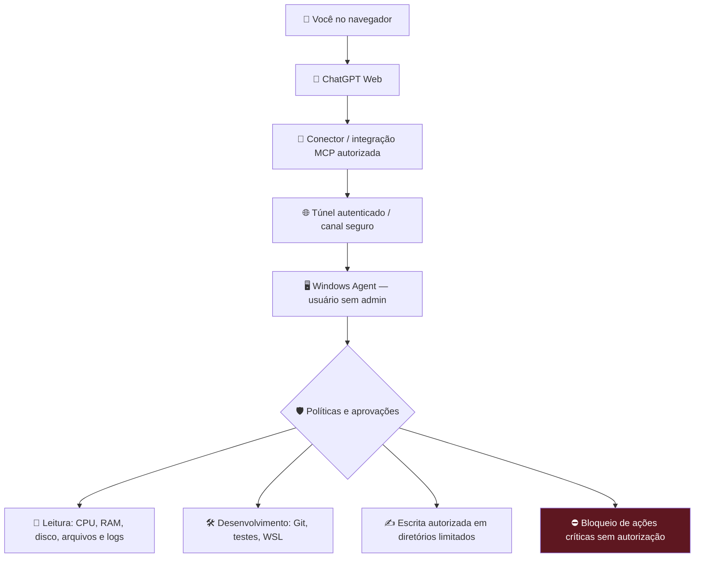
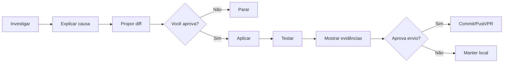

<div align="center">

# 🚀 CHATGPT WEB + WINDOWS AGENT
## 🔥 TRANSFORME SEU PC EM UMA ESTAÇÃO DE DESENVOLVIMENTO COM IA + Code de gratis!

**CHEGA DE COPIAR COMANDOS, ADIVINHAR ERROS E TROCAR DE FERRAMENTA A CADA TAREFA.**

**🖥️ WINDOWS + 🧠 CHATGPT + 🔌 MCP + 🛠️ POWERSHELL/GIT/WSL = UM ASSISTENTE QUE CONSEGUE INSPECIONAR E TRABALHAR NO SEU COMPUTADOR.**


### 💥 CODE FOR FREE: CONSTRUA, ANALISE, TESTE E CORRIJA CÓDIGO PELO CHATGPT + WINDOWS AGENT — COM LINGUAGEM NATURAL!

**Code for Free com ChatGPT + Windows Agent:** você descreve no chat o programa, site, automação ou correção que deseja, e o Windows Agent conectado pode trabalhar diretamente nos arquivos do seu PC, executar comandos e testes autorizados, analisar erros e ajudar a produzir código — sem precisar copiar e colar cada comando. **O ambiente local pode ser montado com ferramentas gratuitas e open source.** A disponibilidade dos modelos, conectores e chamadas no ChatGPT depende do plano, da conta e dos limites vigentes; portanto, *code for free* não significa uso ilimitado da IA.

[⚡ Instalação do zero](#-tutorial-completo-do-zero) · [🧬 Arquitetura](#-entenda-a-arquitetura) · [🔒 Segurança](#-segurança-não-é-opcional) · [🎯 Comandos prontos](#-15-missões-prontas-para-copiar) · [🧯 Solução de problemas](#-solução-de-problemas)

</div>

---

## ⚡ O QUE VOCÊ VAI CONSEGUIR FAZER

Imagine digitar no ChatGPT Web:

> "Faça um diagnóstico somente leitura do meu Windows: CPU, memória, discos, rede, WSL e Docker. Mostre evidências e diga o que merece atenção."

Ou:

> "Abra meu repositório autorizado, investigue a causa do teste quebrado, proponha uma correção pequena e rode a suíte. Não publique nada sem eu aprovar."

Com um **agente Windows compatível com MCP** conectado e permissões adequadas, o ChatGPT pode receber dados reais e executar ações permitidas — não apenas sugerir comandos.

| Antes | Com agente conectado |
|---|---|
| Perguntar qual comando executar | Pedir o resultado da investigação |
| Copiar logs manualmente | Consultar resultados pelas ferramentas do agente |
| Vasculhar código sem contexto | Pesquisar arquivos e relacionar módulos |
| Executar testes um por um | Solicitar execução dentro das permissões |
| Alternar entre várias janelas | Centralizar solicitações na conversa |
| Receio de automação irrestrita | Usar limites de diretório, aprovações e auditoria |

**Não é controle mágico de qualquer PC.** Funciona apenas onde há um agente instalado, conectado, com as ferramentas habilitadas e autorização apropriada.

### 🧠 E O “GPT-6.1” E O “QUASE ILIMITADO”?

O nome ou a disponibilidade de um modelo específico, como **“GPT-6.1”**, **não são garantidos por este projeto**. Escolha no seletor do ChatGPT o modelo realmente oferecido à sua conta. O uso não é ilimitado: existem limites de mensagens, conectores, ferramentas, custos externos e eventuais políticas de uso. O objetivo aqui é **economizar trabalho manual e aproveitar ferramentas locais gratuitas**, não prometer inferência grátis e sem limites.

---

## 🧬 ENTENDA A ARQUITETURA



**Três peças diferentes, que não podem ser confundidas:**

1. **ChatGPT:** conversa, raciocínio e invocação das ferramentas disponíveis à conta.
2. **Agente MCP no Windows:** recebe chamadas de ferramentas e opera **apenas** segundo sua implementação e política.
3. **Ponte remota segura:** permite que uma integração autorizada no ChatGPT alcance o agente. **Não publique uma porta MCP local diretamente na internet.**

> O projeto real de referência usou um agente próprio chamado **windows-pc-agent-ultimate**, com **39 ferramentas identificadas no catálogo**, túnel autenticado, watchdog no logon e operações críticas protegidas. Isso é **um caso prático**, não um pacote instalável disponibilizado automaticamente por este README. Este repositório ainda é um **guia**, não um instalador pronto.

---

# 🧰 FERRAMENTAS E LINKS OFICIAIS

| Ferramenta | Para quê | Link |
|---|---|---|
| ChatGPT | Interface de IA | [chatgpt.com](https://chatgpt.com/) |
| Documentação MCP | Entender e implementar servidores MCP | [modelcontextprotocol.io](https://modelcontextprotocol.io/docs/getting-started/intro) |
| OpenAI Apps / conectores | Consultar integração e disponibilidade atuais | [Central de ajuda ChatGPT](https://help.openai.com/) |
| PowerShell 7 | Terminal moderno do Windows | [GitHub PowerShell](https://github.com/PowerShell/PowerShell) |
| Windows Terminal | Terminal com abas | [Microsoft Windows Terminal](https://learn.microsoft.com/windows/terminal/) |
| Git for Windows | Versionamento local | [git-scm.com](https://git-scm.com/downloads/win) |
| GitHub | Repositórios, PRs e histórico | [github.com](https://github.com/) |
| VS Code | Editor de código gratuito | [code.visualstudio.com](https://code.visualstudio.com/) |
| Python | Scripts, testes e ferramentas MCP | [python.org](https://www.python.org/downloads/) |
| Node.js LTS | Projetos web e ferramentas CLI | [nodejs.org](https://nodejs.org/) |
| WSL | Linux integrado ao Windows | [Microsoft WSL](https://learn.microsoft.com/windows/wsl/install) |
| Docker Desktop | Containers locais (opcional; confira licença) | [docs.docker.com](https://docs.docker.com/desktop/setup/install/windows-install/) |
| Agente Desktop (opcional) | Automação local de interface em cenários compatíveis | [Pesquisar Agent Desktop no npm](https://www.npmjs.com/search?q=agent-desktop) |
| Segurança MCP | Boas práticas de autorização | [Especificação MCP](https://modelcontextprotocol.io/specification/) |

**Custos:** Git, VS Code, WSL e muitos componentes locais têm opções gratuitas. ChatGPT e serviços de inferência externos podem ter limitações ou cobranças; confirme antes de habilitar pagamentos.

---

# 🏁 TUTORIAL COMPLETO DO ZERO

Este tutorial tem duas trilhas: **A — preparar e validar gratuitamente o seu Windows** (reproduzível imediatamente) e **B — conectar um agente MCP ao ChatGPT** (depende de um servidor MCP e uma integração remota autorizada). Não execute scripts desconhecidos com permissões de administrador.

## PASSO 0 — Entenda o requisito mínimo

- Windows 10 ou 11 atualizado.
- Conta Microsoft/Windows com permissão para instalar aplicativos, se necessário.
- Navegador atualizado e conta ChatGPT.
- Internet para baixar ferramentas e conectar o túnel.
- Diretório de trabalho separado de arquivos pessoais sensíveis.
- Backup dos projetos importantes.

**Recomendação:** comece com permissões **somente leitura** e habilite escrita apenas quando você souber exatamente o que o agente executa.

## PASSO 1 — Instalar o Windows Terminal e PowerShell 7

Abra **PowerShell** e verifique o gerenciador de pacotes:

```powershell
winget --version
```

Instale os utilitários oficiais:

```powershell
winget install --id Microsoft.WindowsTerminal --exact
winget install --id Microsoft.PowerShell --exact
```

Feche e reabra o terminal. Confira:

```powershell
$PSVersionTable.PSVersion
Get-ComputerInfo | Select-Object WindowsProductName, OsVersion
```

**Esperado:** PowerShell 7 ao abrir `pwsh`. Se o `winget` não estiver disponível, use a página oficial do [App Installer](https://learn.microsoft.com/windows/package-manager/winget/).

## PASSO 2 — Instalar Git, VS Code, Python e Node.js

Em um terminal PowerShell:

```powershell
winget install --id Git.Git --exact
winget install --id Microsoft.VisualStudioCode --exact
winget install --id Python.Python.3.13 --exact
winget install --id OpenJS.NodeJS.LTS --exact
```

Abra um **novo terminal** para atualizar o PATH e confirme:

```powershell
git --version
code --version
python --version
node --version
npm --version
```

> As versões específicas podem mudar. Para Python, também é válido instalar a versão estável disponível na página oficial, alterando o identificador do pacote conforme `winget search Python.Python`. A falha de um pacote não significa que toda a instalação falhou.

Configure Git com seus **próprios** dados (não copie dados de outra pessoa):

```powershell
git config --global user.name "SEU NOME"
git config --global user.email "seu-email@example.com"
```

## PASSO 3 — Criar um workspace controlado

Use uma pasta dedicada para testes, projetos e permissões limitadas:

```powershell
$Workspace = Join-Path $HOME "AI-Workspace"
New-Item -ItemType Directory -Force -Path $Workspace
Set-Location $Workspace
Get-Location
```

**Por quê?** Um agente autorizado a ler ou escrever apenas nesta pasta é mais fácil de auditar do que um agente com acesso indiscriminado ao disco C:.

## PASSO 4 — Instalar WSL2 (opcional, ótimo para desenvolvimento)

No terminal com permissões adequadas, consulte o estado:

```powershell
wsl --status
wsl --list --verbose
```

Se não estiver instalado:

```powershell
wsl --install -d Ubuntu
```

**A instalação pode exigir administrador e reinicialização.** Não faça isso durante trabalhos importantes em andamento. Após instalar, abra o Ubuntu e conclua a criação de usuário Linux.

Verifique:

```powershell
wsl --list --verbose
wsl -d Ubuntu -- uname -a
```

Documentação: [Microsoft Learn — instalar WSL](https://learn.microsoft.com/windows/wsl/install).

## PASSO 5 — Verificar seu primeiro projeto Git

Dentro do workspace:

```powershell
git clone https://github.com/StockNewsBR/Use-ChatGPTG-Web-to-control-your-PC-e-Code-for-Free-.git
Set-Location Use-ChatGPTG-Web-to-control-your-PC-e-Code-for-Free-
git status
git remote -v
```

Esse clone baixa **a documentação deste projeto**. **Não instala sozinho** o agente do Windows, um conector ChatGPT ou um túnel remoto.

---

# 🔌 TRILHA B — CONECTAR UM AGENTE MCP REAL AO CHATGPT

## PASSO 6 — Escolher o agente certo

Você precisa de um servidor MCP real que ofereça ferramentas para o seu sistema. Há dois caminhos:

**Caminho 1 — Agente próprio (avançado):** desenvolver ou adaptar um servidor MCP usando os SDKs e padrões oficiais. É o caminho usado no caso de referência do **Windows-PC-Agent ULTIMATE**. Como ele não está distribuído neste repositório, seus arquivos, executável e configuração não são fornecidos aqui.

**Caminho 2 — Servidor MCP de terceiros (experimental):** selecionar um projeto confiável, inspecionar o código, verificar licenças, instalar conforme o mantenedor e habilitar somente ferramentas necessárias. **Nunca** dê acesso a senhas, diretórios privados ou operações destrutivas sem entender o software.

Documentação para criar o seu servidor:
- [MCP — introdução](https://modelcontextprotocol.io/docs/getting-started/intro)
- [MCP — servidores](https://modelcontextprotocol.io/docs/learn/server-concepts)
- [MCP — especificação](https://modelcontextprotocol.io/specification/)

**Atenção:** MCP é um protocolo; instalar um SDK MCP **não cria automaticamente** um agente completo de Windows.

## PASSO 7 — Começar em modo READ-ONLY

Configure seu agente para permitir inicialmente apenas:

- Consultas de CPU, RAM, discos e informações do Windows.
- Listagem e leitura de arquivos **dentro de um diretório definido**.
- Inspeção de processos, WSL e Git sem escrita.
- Logs de ferramentas sem incluir segredos.

Deixe **desligado** inicialmente: exclusão, formatação, firewall, serviços, elevação, controle de mouse/teclado, credenciais, publicação na internet e comandos arbitrários.

**Modelo de política recomendado (exemplo conceitual, não YAML pronto de um produto):**

```yaml
policy_example_only:
  allowed_roots:
    - "C:\\Users\\SEU_USUARIO\\AI-Workspace"
  read_tools: true
  write_tools: false
  delete_tools: false
  arbitrary_shell: false
  elevation: false
  windows_ui_control: false
  audit_log: true
  require_approval_for_critical_actions: true
```

Não cole esse exemplo como configuração real sem consultar o formato exigido pelo servidor MCP escolhido.

## PASSO 8 — Configurar a ponte remota com segurança

O ChatGPT Web não executa automaticamente processos do seu Windows. A integração requer um caminho autorizado entre o ChatGPT e o seu servidor MCP.

A topologia recomendada é:

```text
ChatGPT Web
    ↓
Conector/integração MCP habilitada na sua conta
    ↓
Canal remoto autenticado e autorizado
    ↓
Cliente do túnel no PC Windows
    ↓
Servidor MCP local
    ↓
Ferramentas permitidas pela política
```

Requisitos **obrigatórios**:

1. Autenticação de cada cliente e validação do destino.
2. Canal criptografado, protegido por mecanismo apropriado.
3. Serviço local acessível apenas por `127.0.0.1` quando aplicável.
4. Nenhuma porta MCP aberta diretamente no roteador.
5. Segredos protegidos no armazenamento do sistema; nunca em README, histórico ou logs.
6. Reinício automático sem duplicar processos, somente após validação manual.
7. Bloqueio explícito de ações críticas e possibilidade de revogar o acesso.

**Não existe um comando universal para instalar um túnel compatível com todos os servidores e todas as contas ChatGPT.** Siga a documentação da integração MCP disponível em **Configurações → Plugins/Apps** ou no catálogo de conectores exibido para sua conta e do fornecedor do túnel escolhido.

## PASSO 9 — Associar o MCP à sua conta ChatGPT

1. Acesse [ChatGPT](https://chatgpt.com/) no navegador.
2. Abra a área de **configuração de Apps/Plugins/conectores** disponível para a sua conta.
3. Confira se há suporte a **MCP personalizado** ou à integração desejada. A disponibilidade e os nomes dos menus podem variar.
4. Adicione somente o endpoint de integração **autenticado e oficialmente suportado** pelo seu servidor/conector.
5. Revise as permissões solicitadas.
6. Conclua autenticação e aceite apenas os escopos necessários.
7. Abra uma conversa e selecione a ferramenta/conector, se for necessário.
8. Peça uma consulta simples de diagnóstico somente leitura.

**Se a opção de MCP personalizado não aparecer**, não tente contornar segurança nem expor o agente na internet: consulte a documentação vigente e a disponibilidade na sua conta.

## PASSO 10 — Fazer o primeiro teste ponta a ponta

Peça ao ChatGPT:

> "Use o agente Windows conectado e liste suas capacidades. Não modifique nada. Informe a versão, as ferramentas e os diretórios permitidos."

Exemplo de resposta de uma instalação real de referência:

```text
Servidor: windows-pc-agent-ultimate
Versão: 0.2.0-canary
Catálogo: 39 ferramentas identificadas
Modo: operador não administrativo
Política: operações críticas sob confirmação
```

Esses dados pertencem **ao caso de referência** e **não são resultados garantidos** no seu computador.

Segundo teste:

> "Leia apenas as informações do sistema e o consumo de memória. Não execute instalações, não escreva arquivos e não altere configurações."

**Como saber se deu certo?** A ferramenta deve aparecer como executada e retornar dados do **seu** PC, em vez de uma resposta genérica sobre como usar PowerShell.

## PASSO 11 — Habilitar desenvolvimento com aprovação

Depois de validar leitura e auditoria, considere habilitar gradualmente:

1. **Git read-only:** status, branches e diffs.
2. **Testes:** comandos predefinidos em projetos autorizados.
3. **Escrita limitada:** somente no `AI-Workspace`, com diff e backup.
4. **Git commit:** somente após revisão explícita.
5. **Push/PR:** aprovação adicional e branch correta.

**Fluxo ideal:**



## PASSO 12 — Automatizar a inicialização, se necessário

**Só depois de comprovar que a conexão funciona e é segura.** Em uma implantação própria, o inicializador pode ser cadastrado no Agendador de Tarefas do Windows no **logon do usuário**, com permissões limitadas.

Checklist de configuração:

- [ ] Disparar no logon do **usuário correto**.
- [ ] Executar com **menor privilégio possível**.
- [ ] Usar caminho absoluto para o inicializador e arquivo de configuração.
- [ ] Guardar credenciais em armazenamento protegido (por exemplo, DPAPI).
- [ ] Evitar imprimir segredos em logs.
- [ ] Impedir duas instâncias simultâneas (mutex/lock).
- [ ] Implementar verificação de saúde e reinício controlado.
- [ ] Confirmar que tarefas existentes não foram duplicadas.
- [ ] Testar queda e recuperação do túnel.
- [ ] Testar um reboot completo **apenas em janela autorizada**.

Não crie tarefas que executem um script remoto sem revisão. O inicializador real depende da implementação do seu agente.

---

# 🎯 15 MISSÕES PRONTAS PARA COPIAR

> **Cole no ChatGPT após confirmar que o conector Windows está funcionando.** Toda missão deve respeitar permissões, mostrar evidências e evitar mudanças não autorizadas.

### 🖥️ Diagnósticos do Windows

**01 — Raio-X do computador**

> Use o agente Windows para verificar CPU, RAM, Windows, GPU, armazenamento e processos. Somente leitura. Organize os achados por impacto e explique cada evidência.

**02 — Cadê o espaço do disco C:?**

> Analise o consumo de espaço por diretórios autorizados. Mostre os maiores responsáveis, separe cache de dados importantes e proponha limpeza sem excluir nada.

**03 — O que está deixando o PC lento?**

> Analise consumo de CPU, memória e aplicativos de inicialização. Não encerre processos. Identifique gargalos por evidência.

**04 — Wi-Fi vs. Ethernet**

> Verifique interfaces, rota padrão, métricas e qualidade da rede. Diga qual conexão está sendo usada sem alterar a configuração.

**05 — GPU e drivers**

> Identifique GPU, driver, processos gráficos e eventuais problemas de telemetria. Não instale drivers sem autorização.

### 👨‍💻 Desenvolvimento e GitHub

**06 — Entenda um projeto desconhecido**

> Inspecione um repositório autorizado, identifique stack, estrutura, comandos de teste e componentes críticos. Não altere arquivos.

**07 — Investigue um bug**

> Reproduza o erro se for seguro, identifique causa provável com arquivo/linha, proponha o menor patch e peça aprovação antes de editar.

**08 — Testes automáticos**

> Descubra os testes do projeto, rode apenas comandos permitidos, resuma falhas e diferencie erro de ambiente de defeito real.

**09 — Revisão de segurança**

> Faça uma análise estática do repositório autorizado. Procure segredos expostos, permissões excessivas, dependências desatualizadas e riscos de injeção. Não imprima segredos.

**10 — Commit seguro**

> Mostre o diff, resuma arquivos alterados e proponha uma mensagem de commit. Espere minha aprovação explícita antes de fazer commit ou push.

### 🐧 WSL, Docker e automação

**11 — Auditoria do WSL**

> Verifique distribuições, versão do WSL e recursos. Inspecione problemas sem reiniciar nenhuma distribuição.

**12 — Auditoria do Docker**

> Liste imagens, containers, volumes e uso de disco. Não faça prune nem apague volumes. Entregue um plano com riscos.

**13 — Logs de um serviço**

> Leia os logs permitidos do serviço indicado, correlacione horários e proponha um diagnóstico. Não reinicie o serviço.

**14 — Criar um novo projeto**

> Dentro do workspace autorizado, proponha estrutura, dependências e testes. Antes de escrever, mostre os arquivos que serão criados e peça confirmação.

**15 — Auditoria completa, sem sustos**

> Faça um checklist somente leitura de Windows, rede, armazenamento, Git, WSL e Docker. Entregue status PASS/WARN/FAIL com evidências e próximos passos. Não altere absolutamente nada.

---

# 🔒 SEGURANÇA NÃO É OPCIONAL

**A frase “dar 100% de acesso ao PC” parece incrível em uma demonstração, mas é uma péssima configuração padrão.** A combinação certa é **capacidade ampla de diagnóstico + autorização granular para mudanças**.

| Ação | Política inicial |
|---|---|
| Ler telemetria de CPU/RAM/GPU | ✅ Permitida |
| Ver status e diffs Git | ✅ Permitida |
| Ler arquivos no workspace | ✅ Permitida |
| Criar ou editar código | 🔐 Após aprovação e limites |
| Rodar comandos arbitrários | ⛔ Desabilitado inicialmente |
| Deletar arquivos/volumes | ⛔ Aprovação crítica |
| Modificar firewall, serviços ou credenciais | ⛔ Bloqueado |
| Usar mouse, teclado ou capturar tela | ⛔ Só com permissão específica |
| Fazer push ou publicar conteúdo | 🔐 Aprovação explícita |

**Nunca publique:** chaves de API, tokens, arquivos DPAPI, senhas, dumps de ambiente, cookies, dados pessoais ou logs com credenciais.

**Nunca execute** comandos como `irm <url> | iex` ou equivalentes sem auditar a origem e o conteúdo do script. Nunca exponha endpoints MCP sem autenticação, nem desative firewall/antivírus para “fazer funcionar”.

### 🧯 Botão de emergência

Se algo parecer errado:

1. Interrompa as ações do agente na conversa.
2. Desconecte ou revogue o conector/túnel na interface correspondente.
3. Encerre o cliente local e desabilite sua tarefa de inicialização **se você souber exatamente qual é**.
4. Revise logs e autorizações.
5. Se houver suspeita de comprometimento, revogue credenciais afetadas usando os procedimentos oficiais.

---

# 🧯 SOLUÇÃO DE PROBLEMAS

| Sintoma | Causa comum | O que conferir |
|---|---|---|
| ChatGPT não mostra o conector | Recurso não habilitado ou não disponível na conta | Área Apps/Plugins, disponibilidade e documentação |
| Agente não responde | Processo parado, URL errada ou túnel desconectado | Processo local, health e autenticação |
| Falha de autenticação | Chave inválida/expirada ou escopo errado | Provedor, armazenamento protegido e logs sanitizados |
| Funciona localmente, não no ChatGPT | Ponte remota ausente ou mal configurada | Canal autenticado, destino e permissões |
| Ferramenta aparece mas falha | Permissões insuficientes ou comando não suportado | Política do servidor e resposta de erro |
| Duplicação de agentes no logon | Watchdog e fallback sem trava | Mutex/lock e tarefas agendadas |
| Git não encontra comando | PATH ainda não atualizado | Reabrir terminal e `git --version` |
| WSL não inicia | Requisitos de virtualização ou reinicialização pendente | `wsl --status` e documentação Microsoft |
| IA “diz” que executou sem ferramenta | Resposta textual não é evidência de execução | Exigir saída de chamada MCP e resultado verificável |
| Limites do ChatGPT | Cota, plano ou política do produto | Verificar limites e disponibilidade atuais |

---

# 💸 QUANTO CUSTA? DÁ PARA FAZER CODE FREE?

**Sim, é possível montar o ambiente de programação local com várias ferramentas gratuitas.** Mas é importante separar as camadas:

| Camada | Situação de custo |
|---|---|
| Git e GitHub (recursos básicos) | Opções gratuitas |
| VS Code e PowerShell | Gratuitos |
| WSL | Incluído como recurso do Windows compatível |
| Python e Node.js | Gratuitos |
| Servidor MCP próprio | Software pode ser gratuito; manutenção é sua |
| Túnel remoto | Pode ter custo ou limite, depende do fornecedor |
| ChatGPT | Plano gratuito e planos pagos, com limites diferentes |
| Inferência/API externa | Pode ter cobrança por uso |
| Computação do seu PC | Usa seus recursos, energia e armazenamento |

**“Quase ilimitado” só faz sentido como capacidade de repetir tarefas locais, dentro dos recursos do PC e das cotas aplicáveis. Não significa mensagens ilimitadas, acesso irrestrito ou API gratuita.**

---

# ❓ PERGUNTAS FREQUENTES

**Preciso saber programar?** Para os diagnósticos básicos, pouco. Para criar e conectar um servidor MCP próprio com segurança, experiência técnica ajuda muito.

**O agente funciona no navegador?** A conversa sim; as operações acontecem em um agente instalado/conectado ao seu computador, não diretamente pelo navegador.

**Funciona com qualquer modelo?** Depende das opções atuais da sua conta e do suporte do produto a ferramentas/conectores. Não há garantia de um modelo específico.

**Posso controlar o mouse e a tela?** Somente se o agente tiver ferramentas específicas para isso e você conceder autorização. MCP por si só não oferece controle visual.

**Posso usar no meu projeto comercial?** Em geral, ferramentas de código podem ser usadas em projetos comerciais conforme suas licenças; verifique cada dependência e o plano de serviços externos.

**Este repositório instala tudo com um clique?** **Não.** Ele é um tutorial e uma referência de arquitetura. Um instalador reproduzível exigiria publicar o servidor MCP, o inicializador, a configuração segura e testes para diferentes PCs.

**É possível deixar o agente sempre ligado?** Sim, com inicialização no logon, watchdog, detecção de duplicações e políticas. Isso deve ser configurado e testado separadamente.

---

# 📚 PARA IR ALÉM

- [🔌 MCP: documentação oficial](https://modelcontextprotocol.io/docs/getting-started/intro)
- [🧠 ChatGPT](https://chatgpt.com/)
- [🐧 Microsoft WSL](https://learn.microsoft.com/windows/wsl/)
- [🧰 Git](https://git-scm.com/doc)
- [💻 VS Code](https://code.visualstudio.com/docs)
- [🚀 GitHub Docs](https://docs.github.com/)
- [⚡ DeepSeek Harness 2.0 — GOD SETUP (guia complementar)](https://github.com/StockNewsBR/New-DeepSeek-Harness-2.0-GOD-Setup)

---

<div align="center">

## 🚀 O FUTURO DO DESENVOLVIMENTO É CONVERSAR COM A IA — E VER O TRABALHO ACONTECER.

**Comece com leitura. Valide a conexão. Habilite código com aprovação. Automatize com responsabilidade.**

**⭐ Se este guia te ajudou, marque uma estrela no repositório e compartilhe com outros desenvolvedores.**

[⬆️ Voltar ao topo](#-chatgpt-web--windows-agent)

**Feito para aprender, experimentar e desenvolver com autonomia e segurança.**

</div>
